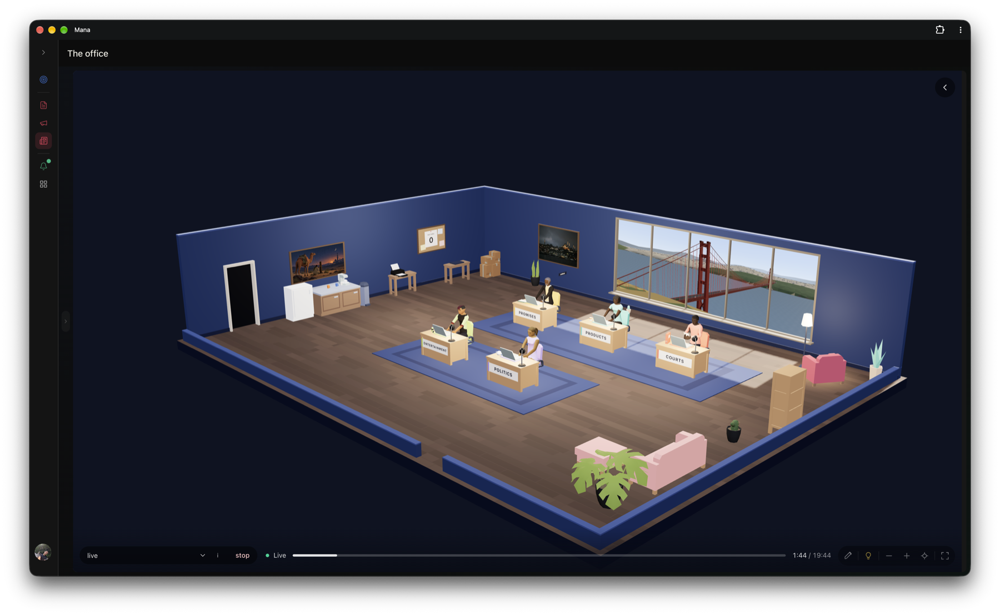

# Mana

**Your own AI office.** A self-hosted personal AI that keeps your goals, money, people and projects in one place. Its agents share one memory and keep working while you're away.

[](https://mana.serdarsalim.com)

**[Try the demo](https://mana.serdarsalim.com)**. No sign-up. Everything you do stays in your browser.

## What's in the demo

- Goals with weekly tasks, expenses and net worth, groceries and pantry
- Circles of people with notes, learning paths and a blog writer
- The office, where your agents sit at their desks
- A chat owl with scripted replies, so you can see how talking to Mana feels

It's the real Mana app with the server swapped for your browser's storage, so it works without a backend, an AI model or an account. Voice, live AI and background agents need a real Mana. The full server version will be published later.

## Run it locally

```bash
cd public
python3 -m http.server 8080
```

Then open http://127.0.0.1:8080. How the demo gets built and published is in [docs/publishing.md](docs/publishing.md).

## License

[AGPL-3.0](LICENSE)
